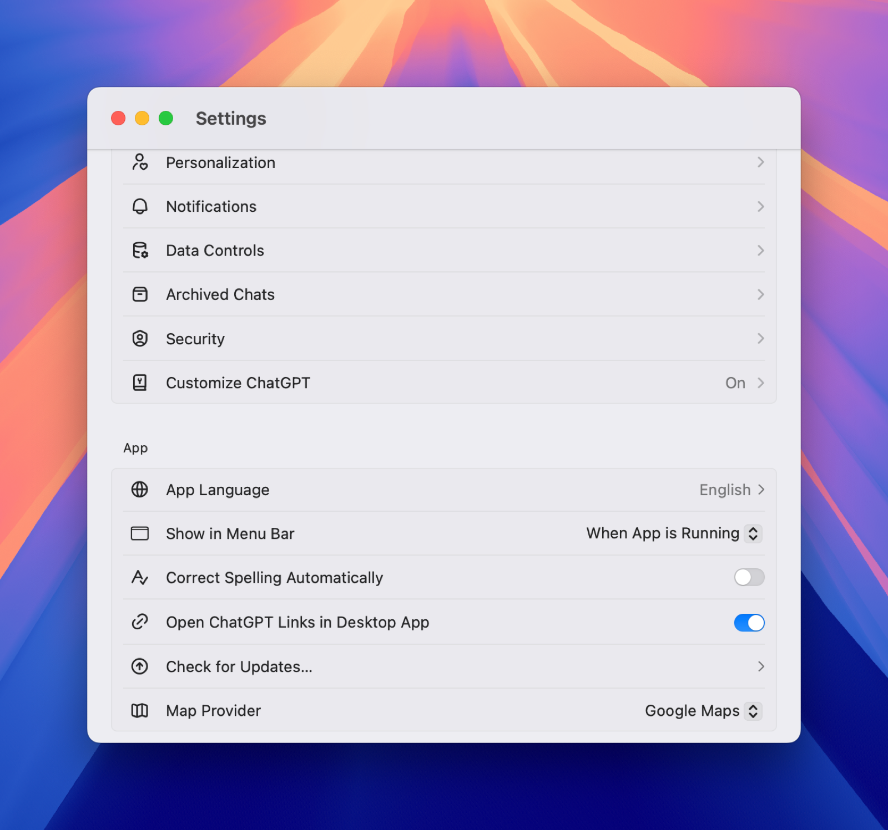
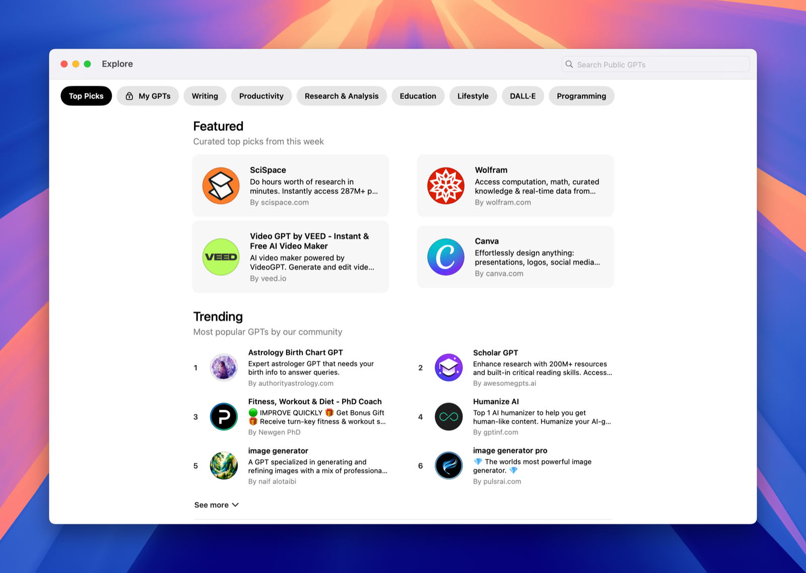

> [!NOTE] Fuente original: [carlosluengo.com](https://carlosluengo.com/posts/chatgpt-gpt4o-overview)

ChatGPT is more than just a chatbot—it's a powerful AI assistant that can help you brainstorm, code, learn, and automate tasks. In this overview, discover its main features, practical use cases, and how to unlock even more value with custom GPTs.Introduction  

ChatGPT is an artificial intelligence assistant powered by OpenAI's GPT-4o model. It communicates in natural language, understands context, and generates meaningful responses in seconds. Whether you need inspiration, technical help, or simply a pleasant conversation, ChatGPT can become an indispensable tool in your daily routine.   

  

### Main Features  

| Feature | What it does | Why it matters |

|--------|---------------|----------------|

| **Natural language conversation** | Answers questions, explains concepts, and holds fluid conversations. | Provides instant support and information with no jargon. |

| **Data and code analysis** | Runs Python, analyses files, and creates charts. | Saves time debugging scripts or visualising results. |

| **Web browsing** | Searches for up-to-date sources when needed. | Access the latest data without leaving the chat. |

| **Image generation and editing (DALL·E)** | Creates or edits images from text prompts. | Ideal for presentations, social media, and prototypes. |

| **Voice input and output** | Listens to your questions and responds with voice. | Perfect for hands-free use while driving or cooking. |

| **File handling** | Summarises PDFs, converts tables, extracts text from images. | Makes handling long or scanned documents easier. |

| **Customisation and memory** | Adjusts tone, language, and remembers preferences if enabled. | Personalised experience without repeating instructions. | 

  

### Example Use Cases  

- **Quick brainstorming**  

  - Generate brand name ideas for an artisanal coffee company.  

- **Writing and editing**  

  - Turn messy notes into a professional report using British spelling.  

- **Accelerated learning**  

  - Summarise a 30-page academic paper into five clear bullet points.  

- **Code assistance**  

  - Explain why a block of Python code throws an `IndexError` and suggest a fix.  

- **Personal planning**  

  - Build a weekend itinerary in London with indoor alternatives in case of rain.  

- **Customer support**  

  - Generate polite, accurate replies to common user enquiries.  

### Custom "GPTs"  

Since late 2023, you can create and share your own GPTs—specialised versions of ChatGPT that combine instructions, knowledge, and external tools.  

#### How to explore them  

- Open the **Explore GPTs** panel and browse through categories like "Writing", "Productivity", and "Education".  
- Try public GPTs or duplicate one to customise it for your own needs.  
- Add your own data (e.g., an internal guide) so your GPT can respond with tailored expertise.  
 

  

#### When to build your own GPT  

| Scenario | Benefit |

|----------|---------|

| **Internal support** | A GPT trained on company policies answers staff questions. |

| **Training** | A GPT that delivers course content and self-assessments. |

| **Marketing** | A GPT that creates on-brand copy consistently. |

### Conclusion  

ChatGPT blends powerful AI with a user-friendly, flexible interface. By understanding the basic features, use cases, and the new wave of custom GPTs, you'll be equipped to get the most out of it from day one. Explore, experiment, and discover how it can streamline your everyday tasks!

## También te puede interesar

- [How to Build Your Own GPT in ChatGPT](/blog/build-your-own-gpt-chatgpt)
- [Deep Research with ChatGPT: A Practical Guide](/blog/deep-research-chatgpt-guide)
