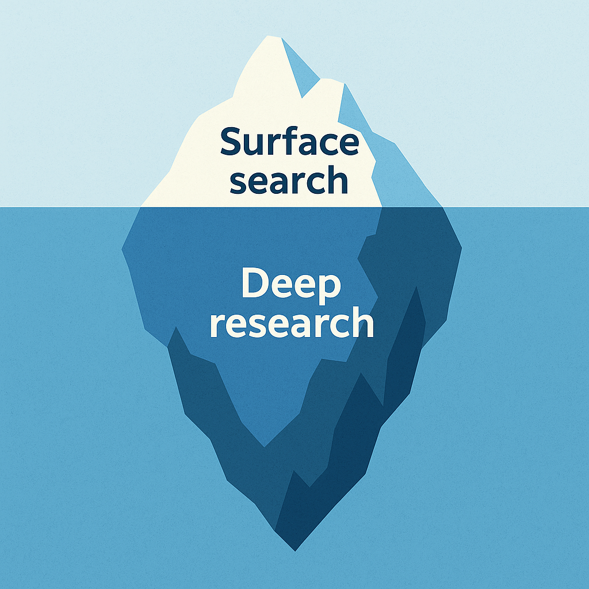
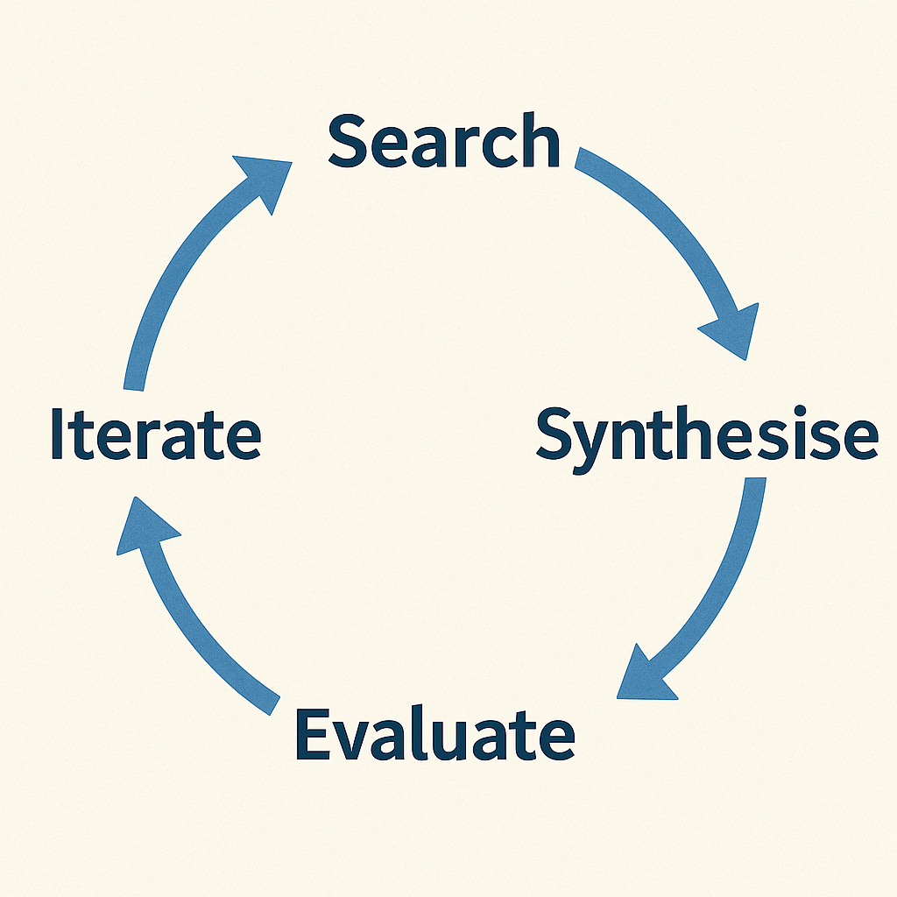
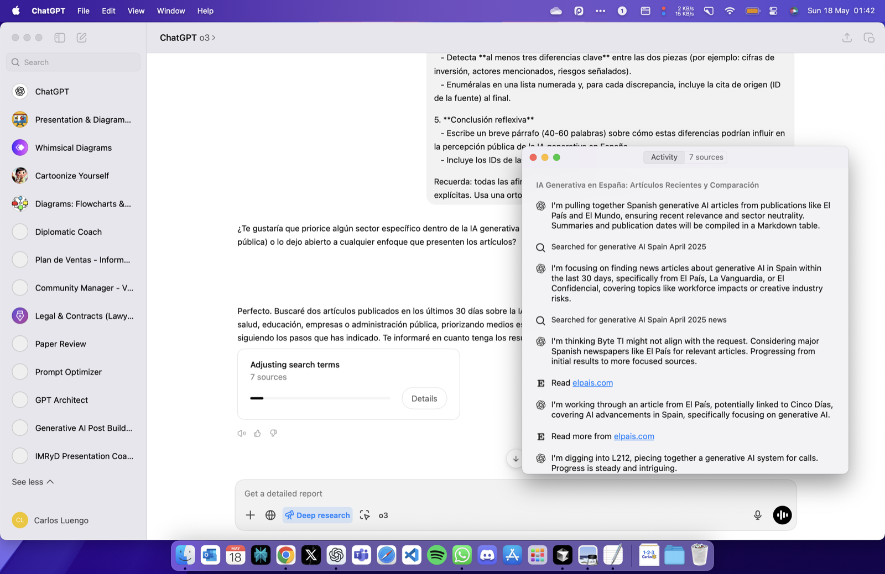

> [!NOTE] Fuente original: [carlosluengo.com](https://carlosluengo.com/posts/deep-research-chatgpt-guide)

Deep research is more than just skimming search results—it's a disciplined, multi-stage approach to finding, evaluating, and synthesising information. In an era where AI generates vast amounts of content and misinformation is rife, mastering deep research is essential for anyone who wants to make well-informed decisions, uncover real insights, and maintain intellectual integrity. This guide shows you how to use ChatGPT and OpenAI tools to bring depth and rigour to your research process.

> *Bringing rigour and depth to your information-gathering workflow with OpenAI tools.* 


  

### Table of Contents

- [ Table of Contents ](#table-of-contents)
- [ What Do We Mean by "Deep Research"? ](#what-do-we-mean-by-deep-research)
- [ Why Deep Research Matters in the Age of AI ](#why-deep-research-matters-in-the-age-of-ai)
- [ Core Concepts ](#core-concepts)

  - [ 1. Problem Definition ](#1-problem-definition)
  - [ 2. Query Engineering ](#2-query-engineering)
  - [ 3. Toolchain Awareness ](#3-toolchain-awareness)
  - [ 4. Source Evaluation ](#4-source-evaluation)
  - [ 5. Iterative Synthesis ](#5-iterative-synthesis)

- [ A Step-by-Step Workflow with ChatGPT ](#a-step-by-step-workflow-with-chatgpt)
- [](#)
- [ Advanced Techniques ](#advanced-techniques)
- [ Common Pitfalls \& How to Avoid Them ](#common-pitfalls--how-to-avoid-them)
- [ Quick Checklist ](#quick-checklist)
- [ Further Reading ](#further-reading)
 


  

### What Do We Mean by "Deep Research"?

Deep research goes beyond a quick skim of search-engine snippets. It is a **structured, multi-stage process** designed to:

- formulate precise research questions,
- retrieve **comprehensive, high-quality** sources,
- critically appraise evidence, and
- synthesise findings into a coherent narrative.

Think of it as moving from the **surface web** to the **substance layer**—where context, nuance, and original data live.

### Why Deep Research Matters in the Age of AI

- **Information Overload** – Estimates suggest that over 300 million pages are added to the web every day. Without a disciplined approach, signal is drowned by noise.
- **Misinformation Risks** – Automated content generation has made it easier for unverified material to circulate.
- **Competitive Advantage** – Teams who *master* deep research spot insights sooner and make better-informed decisions.
- **Intellectual Integrity** – Proper citation and source analysis uphold ethical standards and build trust.

### Core Concepts

#### 1. Problem Definition

Spend time crafting a research question that is **specific, measurable, and bounded**. A clear scope prevents rabbit holes.

#### 2. Query Engineering

Leverage advanced search operators (e.g. `site:`, `filetype:`, quotes) and recency or domain filters. ChatGPT's `search_query` tool can embed these parameters programmatically.

#### 3. Toolchain Awareness

Deep research is rarely a single-tool affair. Typical components include:

| Need                  | Suggested OpenAI Tool      | Example                                   |

|-----------------------|---------------------------|-------------------------------------------|

| Rapid literature scan | `web.run` – `search_query`| Identify peer-reviewed studies from 2024-2025 |

| Critical appraisal    | Chat analysis prompts      | Compare methodologies                     |

| Data extraction       | `python_user_visible`      | Parse CSV figures                         |

| Visual synthesis      | `image_gen`               | Create conceptual diagrams                |

#### 4. Source Evaluation

Apply a checklist such as **CRAAP** (Currency, Relevance, Authority, Accuracy, Purpose) or **RAVEN** (Reputation, Ability to observe, Vested interest, Expertise, Neutrality).

#### 5. Iterative Synthesis

Alternate between **divergent searching** (broadening) and **convergent summarisation** (narrowing) until the answer is robust. 


  

### A Step-by-Step Workflow with ChatGPT

- **Clarify the Objective**  

   *Prompt:* *"In one sentence, what decision will this research inform?"*

- **Map Sub-questions**  

   Draft a mind-map or list of granular queries.

- **Design Targeted Searches**  

   Use `web.run` with structured parameters:

   ```json

   {

     "search_query": [{

       "q": "impact of transformer models on protein folding research",

       "recency": 365,

       "domains": ["nature.com", "science.org"]

     }]

   }

   ```

- **Collect & Cite Sources**  

   Save reference IDs (e.g. `turn3search4`) immediately; they become your formal citations.

- **Critically Appraise**  

   Ask ChatGPT to compare samples, highlight limitations, or request methodological tables.

- **Extract Data Programmatically**  

   When numerical tables appear, load them via `python_user_visible` to compute statistics.

- **Synthesise Findings**  

   Prompt ChatGPT to draft an executive summary; refine iteratively.

- **Produce Final Artefacts**  

   Convert notes into reports, slide decks, or knowledge-base articles. 


  

### Advanced Techniques

| Technique             | Benefit                        | Example Prompt                                      |

|-----------------------|-------------------------------|-----------------------------------------------------|

| **Recency Filtering** | Focus on the latest evidence  | `recency":30` for last-month material               |

| **Domain Whitelisting** | Cut noise by restricting to trusted sites | `domains":["who.int"]`                  |

| **Multilingual Search** | Access diverse perspectives  | "Translate the query into Japanese and Spanish, then search" |

| **Image Query**       | Retrieve visual data (graphs, maps) | `image_query` for "lithium mine satellite photo" |

| **Automated Alerts**  | Stay current on evolving topics | Schedule a weekly `automations` task              |

### Common Pitfalls & How to Avoid Them

- **One-and-Done Searching** – Iterate; the first query is rarely perfect.
- **Citation Drift** – Always attach the reference ID when the result appears.
- **Confirmation Bias** – Deliberately search for disconfirming evidence.
- **Tool Mis-match** – Use `python` for private analysis, `python_user_visible` for user-facing tables and charts.
- **Over-summarisation** – Preserve key figures and methodological details; don't compress everything into abstract prose.

### Quick Checklist

- [ ] Clear research question defined
- [ ] Sub-questions mapped
- [ ] Search queries include operators / filters
- [ ] Sources cited with IDs
- [ ] Evaluation checklist (CRAAP/RAVEN) applied
- [ ] Data analysed or verified programmatically where needed
- [ ] Findings synthesised with limitations noted
- [ ] Outputs formatted for target audience

### Further Reading

- *OpenAI Cookbook* – Practical examples for `web.run` and `python_user_visible` workflows.
- *Cornell University Library – Evaluating Sources* – Detailed CRAAP guidance.
- *The Craft of Research* by Booth, Colomb & Williams – Classic text on framing research questions.

## También te puede interesar

- [ChatGPT with GPT-4o: Features, Use Cases, and Custom GPTs](/blog/chatgpt-gpt4o-overview)
- [Navigating APCs, Institutional Agreements, and Prestige Publishing](/blog/navigating-apcs-guide)

--
