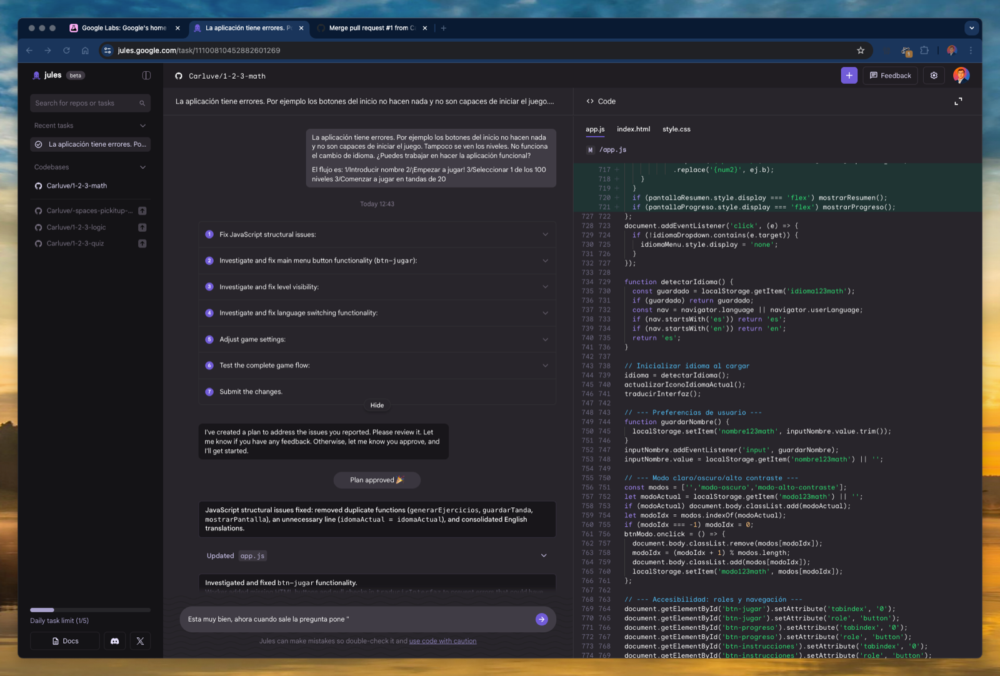
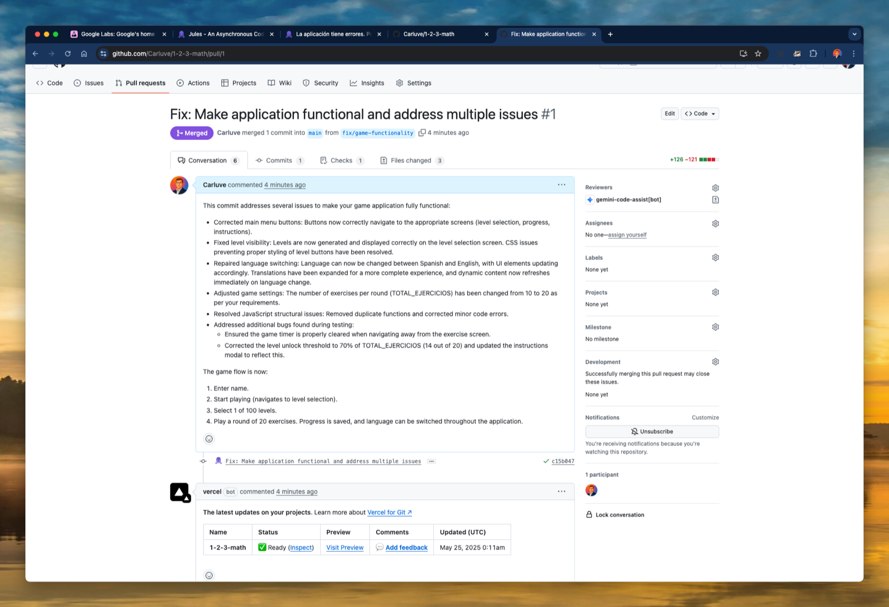
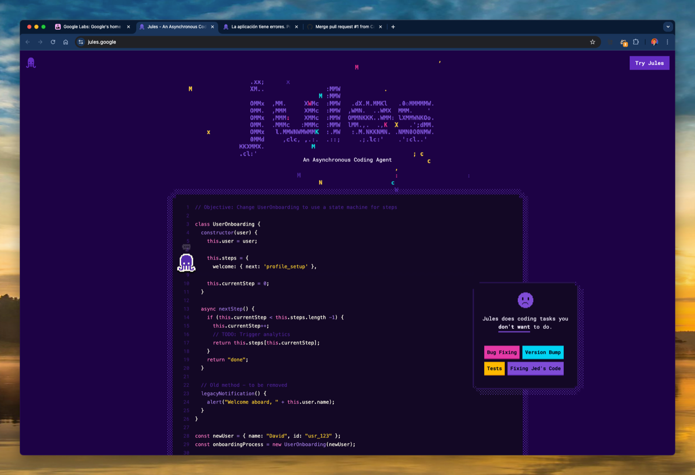

> [!NOTE] Fuente original: [carlosluengo.com](https://carlosluengo.com/posts/fixing-123-math-with-jules)

In this post, I share how I used [ Jules ](https://jules.google), Google’s asynchronous coding assistant, to fix a broken educational game project I had abandoned. The app, [ 1-2-3 Math ](https://www.carlosluengo.com/portfolio/2025-05-123math/), had various issues—broken buttons, language-switching bugs, and general logic problems. I decided to test Jules as a dev assistant and was positively surprised.

### 🤖 What is Jules?

Jules is an experimental tool from Google Labs. Think of it as a GPT-based developer agent that understands your repo, can reason through issues asynchronously, and even make pull requests with real code suggestions. You just describe your problem in natural language, and Jules builds a step-by-step plan, implements the changes, and pushes commits back.

##### 📸 Screenshot of Jules plan and code fix 

  

### 💡 Why I Used Jules

The app was failing in several critical ways:

- Navigation buttons didn’t work.
- Levels weren’t loading properly.
- Language toggling between Spanish and English was broken.
- Game logic and thresholds were hardcoded and incorrect.

I didn’t want to spend hours debugging the front-end logic, so I gave Jules a try.

### ⚙️ How Jules Helped

Jules broke the task into a detailed checklist:

- Fix JavaScript structural issues.
- Repair menu button (`btn-jugar`) navigation.
- Rebuild level rendering logic.
- Enable dynamic language switching.
- Adjust game settings (rounds, thresholds).
- Ensure correct flow: name > level > play.

Each step was tracked, executed, and documented. In the final commit, Jules:

- Removed duplicate functions.
- Rewrote navigation and menu logic.
- Fixed level visibility CSS bugs.
- Introduced a cleaner language-switching mechanism.
- Recalibrated the level threshold logic to 70% dynamically.

##### 📸 Screenshot of merged Pull Request on GitHub 

  

### ✅ Benefits of Using Jules

- **Speed**: Jules fixed everything in less than 10 minutes of actual time investment from my side.
- **Clarity**: Clear commit messages and explanations at each step.
- **Autonomy**: I could just approve plans and see working results, with very little micromanagement.
- **Confidence**: I had control to test, verify and merge safely.

### 🔚 Conclusion

Jules isn’t just a toy; it’s a powerful productivity multiplier for developers. For projects that are small, experimental, or stuck in debugging limbo, it feels like having a reliable junior dev always available. For me, it helped bring [ 1-2-3 Math ](https://www.carlosluengo.com/portfolio/2025-05-123math/) back to life.

I’ll definitely keep experimenting with Jules—especially for prototype-level work or legacy bugs.

##### 📸 Screenshot of Jules homepage 

## También te puede interesar

- [Testing Amazon Q Developer on GitHub](/blog/testing-amazon-q-developer-on-github)
- [Vibe Coding: The New Software Culture](/blog/2025-05-01-vibe-coding-culture-productivity)
