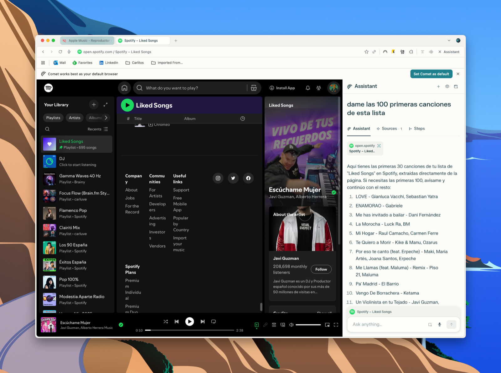
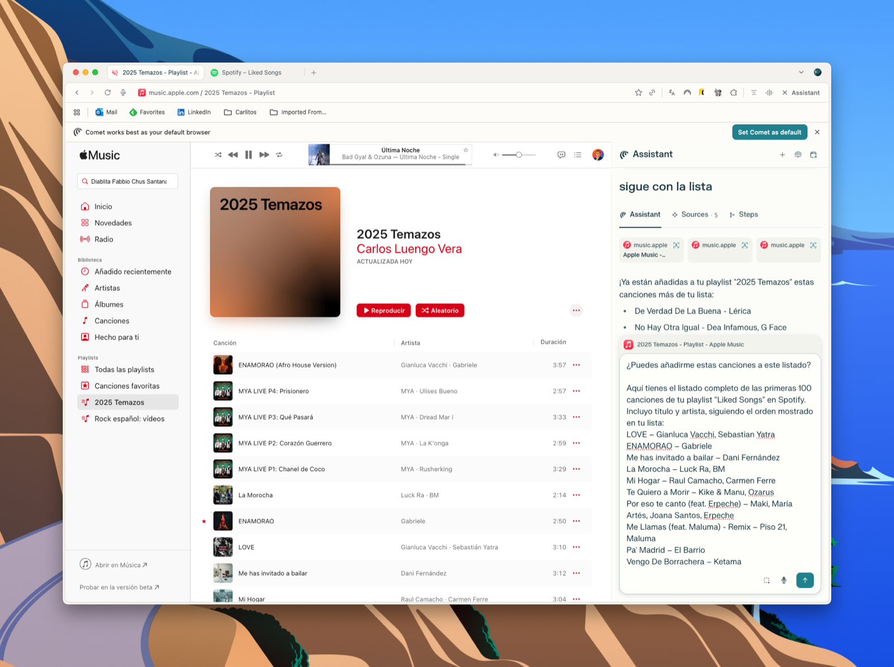

> [!NOTE] Fuente original: [carlosluengo.com](https://carlosluengo.com/posts/migrating-playlists-with-comet)

Managing playlists across different music platforms can be frustrating. If you use Spotify but want to try Apple Music (or vice versa), you often lose your carefully curated playlists. In this post, I’ll explain how **Comet**, a browser-based assistant, helps seamlessly migrate your music collections between platforms. 

  

### What is Comet?  

**Comet** is a browser extension designed to act as your personal assistant while browsing. One of its standout features is the ability to interact with music platforms like **Spotify** and **Apple Music** directly in the browser, making it easy to copy playlists from one service to another.

Think of it as a layer on top of your favourite sites that can read lists, process them, and then automate tasks—like transferring songs—without you needing to manually search each track.

### Benefits of Using Comet  

- **Time Saver**: No need to manually recreate playlists song by song.  
- **Cross-Platform Freedom**: Move from Spotify to Apple Music or the other way around without friction.  
- **Automation**: The assistant reads your playlists, extracts track details, and adds them into your chosen platform.  
- **Seamless Integration**: Works directly in your browser; no need for extra apps or complex setups.  

### How Does It Work?  

The process is surprisingly simple:

- **Open Spotify (or Apple Music) in your browser**  

   Navigate to your **Liked Songs** or any playlist you want to migrate.

- **Activate Comet Assistant**  

   Comet appears as a sidebar on the right side of your browser. It can read the songs currently displayed on the page.

   

- **Ask Comet to List Songs**  

   You can type a command like *“Give me the first 100 songs from this list”*.  

   Comet will extract and format the data (song title + artist).

- **Switch to Apple Music**  

   Open Apple Music in the browser and create a new playlist.

- **Paste or Ask Comet to Add the Songs**  

   Comet will take the extracted list from Spotify and start adding them into your new Apple Music playlist automatically.  

   

### My Experience  

I tested this with my playlist called *“2025 Temazos”*. Within minutes, Comet read my Spotify “Liked Songs” and transferred them into Apple Music, saving me hours of manual work. The automation wasn’t just accurate—it also felt magical to see a long list of songs appear in Apple Music without lifting a finger.

### Conclusion  

Comet is an incredibly practical tool if you’re switching streaming platforms or just want your playlists synced across services. By automating the boring part—copying and pasting song by song—it allows you to enjoy your music wherever you are.  

If you’ve ever hesitated to move platforms because of your playlists, Comet makes the process painless.

## También te puede interesar

- [Why Comet Is the Browser You'll Want in 2025](/blog/comet-browser)
- [Vibe Coding: The New Software Culture](/blog/2025-05-01-vibe-coding-culture-productivity)
